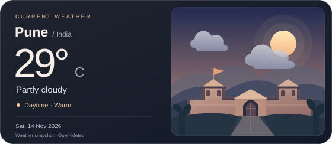

<h1 align="center">Hi, I'm Sahil 👋</h1>

<strong>Backend Engineer • Learner • Builder</strong>

Based in Pune, India. I enjoy building practical software and finding better ways to work.

---

## 🧑‍💻 About Me

I’m a curious software engineer, eager to understand **software fundamentals** and turn that understanding into **meaningful contributions**.

- 🧠 **Driven by curiosity** — I enjoy figuring out how things work and why design choices matter.
- 🛠️ **Learning by building** — from MERN projects in college to Python, ML, and deep learning explorations.
- 🤝 **Growing through collaboration** — sharing what I learn and improving software alongside others.

---

## 💼 Work Experience

### Backend Engineer · Current Role

For the past **two years**, I’ve been working as a backend engineer at my company, building backend applications with **Java and Spring Boot** and working with **Azure**.

## 🛠️ Skills & Tools

  

  
  &nbsp;&nbsp;
  

AI tools: Claude · Codex

---

## 🤝 Open Source Contributions

- 🎉 My first merged open-source pull request was in **Kestra**!

## 📚 Currently Exploring

- **System design** — learning how to design reliable applications and understand architectural trade-offs.
- **Open source** — looking for more opportunities to contribute, collaborate, and learn from other developers.
- **AI tools in everyday development** — exploring new features in tools like Claude and Codex to streamline daily work.
- **Hackathons** — keen to participate in more events, try new technologies, and build with others.

---

## 🔥 GitHub Contribution Streak

  

---

Thanks for visiting! Explore my repositories below. ✨

  

<!-- Codex icon adapted from LobeHub Icons (MIT). See assets/lobehub-LICENSE. -->
